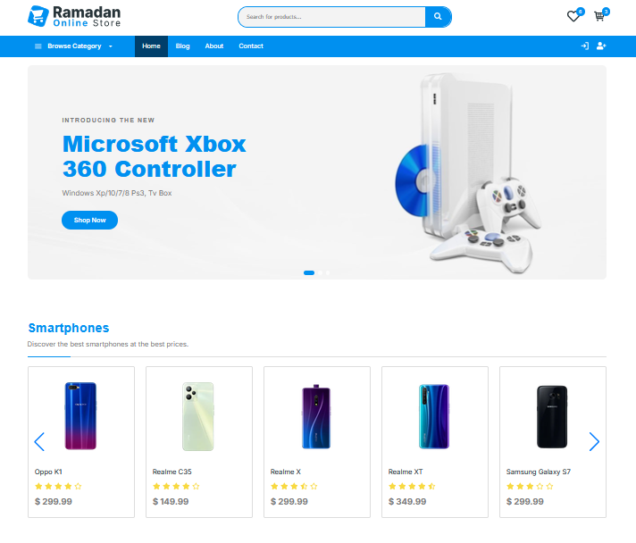
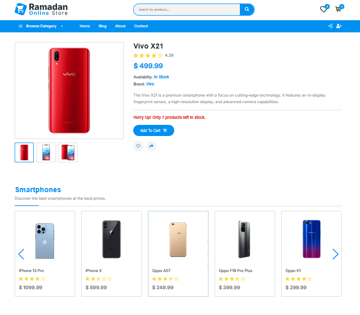
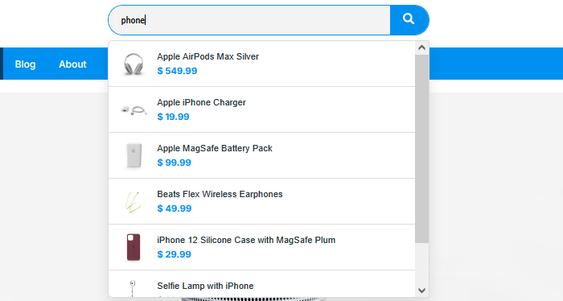
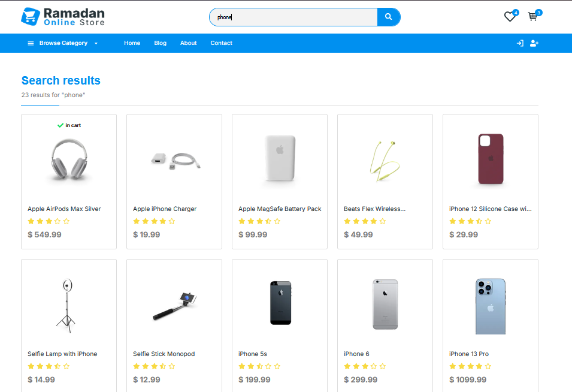
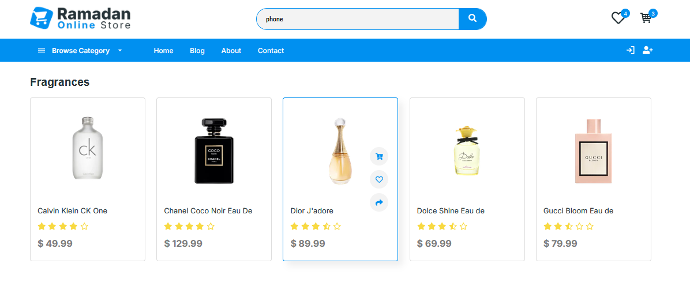
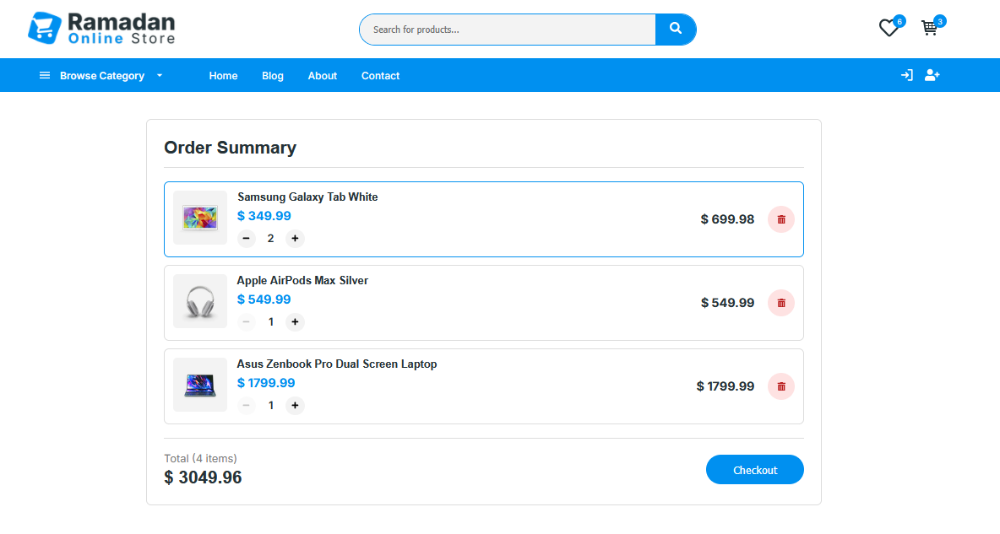
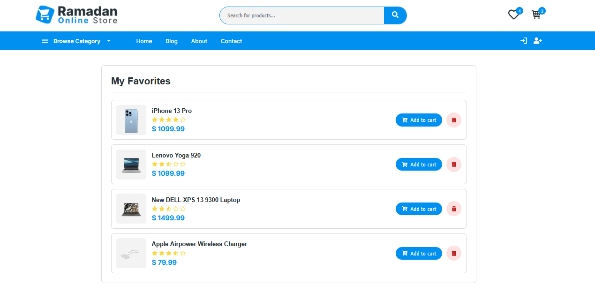
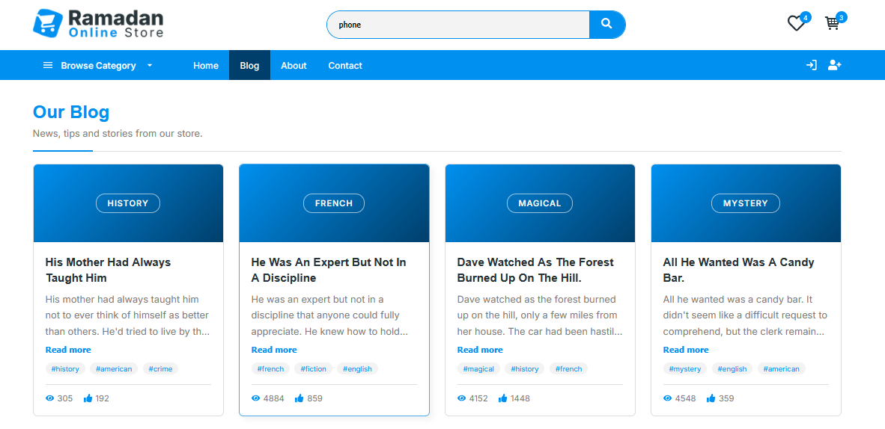
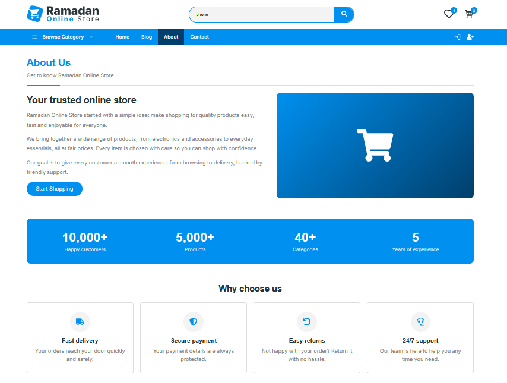
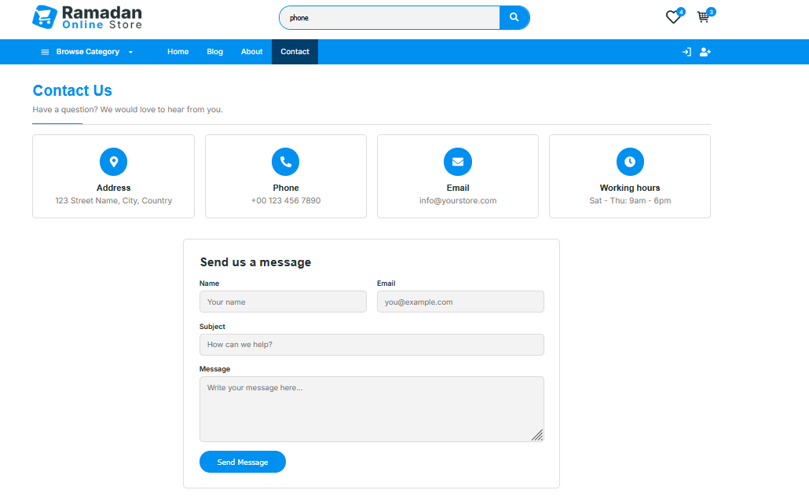

# Ramadan Online Store
 
A modern, responsive e-commerce front-end built with **React** and **Vite**. It fetches real product data from the free [DummyJSON](https://dummyjson.com/) API and includes a shopping cart, favorites, live search, a blog, and more.
 
## Screenshots
 
| Home | Product Details |
| --- | --- |
|  |  |
 
| Live Search | Search Results |
| --- | --- |
|  |  |
 
| Category | Cart |
| --- | --- |
|  |  |
 
| Favorites | Blog |
| --- | --- |
|  |  |
 
| About | Contact |
| --- | --- |
|  |  |
 
## Features
 
- **Home page** with an animated hero slider and a product slider for each category
- **Live search** with instant suggestions and a full search results page
- **Browse Category** menu loaded from the API
- **Product details** page with an image gallery, rating, stock info and related products
- **Shopping cart** with quantity controls, stock limits and an order total
- **Favorites** list with the ability to move items to the cart
- **Cart and favorites counters** in the header, saved in `localStorage` so they survive a refresh
- **Blog** page with pagination and expandable posts
- **About** and **Contact** pages (the contact form has client-side validation)
- **Loading skeletons** for a smooth experience while data is loading
- **Responsive design** for desktop, tablet and mobile
## Tech Stack
 
| Tool | Purpose |
| --- | --- |
| [React](https://react.dev/) | UI library |
| [Vite](https://vitejs.dev/) | Build tool and dev server |
| [React Router](https://reactrouter.com/) | Client-side routing |
| [Swiper](https://swiperjs.com/) | Sliders and carousels |
| [React Icons](https://react-icons.github.io/react-icons/) | Icons |
| [DummyJSON](https://dummyjson.com/) | Products, categories, search and blog posts API |
| Context API | Global state for the cart and favorites |
 
## Getting Started
 
### Prerequisites
 
- [Node.js](https://nodejs.org/) (version 18 or later)
- npm (comes with Node.js)
### Installation
 
```bash
# 1. Clone the repository
git clone https://github.com/Cooooooooooder/React_Online_Store.git
 
# 2. Go to the project folder
cd React_Online_Store
 
# 3. Install dependencies
npm install
 
# 4. Start the development server
npm run dev
```
 
Then open the local address shown in the terminal (usually `http://localhost:5173`).
 
### Available Scripts
 
| Command | Description |
| --- | --- |
| `npm run dev` | Start the development server |
| `npm run build` | Create a production build in the `dist` folder |
| `npm run preview` | Preview the production build locally |
| `npm run lint` | Check the code with ESLint |
 
## Project Structure
 
```
src/
├── components/
│   ├── CategoryLoading/        # Skeleton for category pages
│   ├── GlobalComponents/       # Shared components (e.g. Stars)
│   ├── header/                 # Top header, bottom header and Search
│   ├── HeroSlider/             # Home page hero slider
│   ├── ProductDetailsLoading/  # Skeleton for the product page
│   ├── SlideProductLoading/    # Skeleton for product sliders
│   └── slideProducts/          # Product card and product slider
├── context/
│   ├── CartContext.jsx         # Cart state (add, remove, quantity)
│   └── FavoriteContext.jsx     # Favorites state
├── img/                        # Images and logo
├── page/
│   ├── about/
│   ├── blog/
│   ├── cart/
│   ├── Category/
│   ├── contact/
│   ├── favorite/
│   ├── ProductDetails/
│   ├── SearchResults/
│   └── Home.jsx
├── App.jsx                     # Routes
├── index.css                   # Global styles and CSS variables
└── main.jsx                    # App entry point
```
 
## Routes
 
| Path | Page |
| --- | --- |
| `/` | Home |
| `/product/:id` | Product details |
| `/category/:slug` | Products of a category |
| `/search?q=term` | Search results |
| `/cart` | Shopping cart |
| `/favorites` | Favorites |
| `/blog` | Blog |
| `/about` | About us |
| `/contact` | Contact us |
 
## API
 
All data comes from DummyJSON, no API key needed:
 
- `GET /products/categories`: list of categories
- `GET /products/category/:slug`: products of a category
- `GET /products/:id`: a single product
- `GET /products/search?q=`: search products
- `GET /posts`: blog posts
## Notes and Future Improvements
 
- The **Checkout** button and the **Sign in / Register** icons are placeholders for now.
- The contact form validates the input but does not send messages to a server yet. It can be connected to a service such as EmailJS or Formspree.
- Possible next steps: user authentication, a real checkout flow, product filters and sorting, and dark mode.
## Author
 
**Ahmed Ramadan**
 
- GitHub: [@Cooooooooooder](https://github.com/Cooooooooooder)
## License
 
This project is for learning purposes.
 
